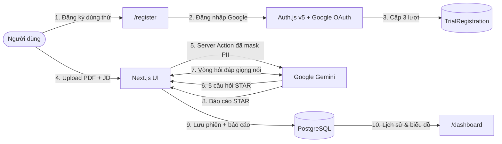

<p align="center">
  
</p>

<h1 align="center">AI-Interview</h1>

<p align="center">
  <strong>Nền tảng phỏng vấn giả lập thông minh chuẩn STAR dành cho sinh viên và người chuyển ngành</strong>
</p>

<p align="center">
  
  
  
  
  
</p>

---

## 🎯 Giới Thiệu Dự Án

**AI-Interview** là web phỏng vấn giả lập AI dành cho sinh viên và người chưa có kinh nghiệm phỏng vấn thực tế. Mục tiêu: **trải nghiệm mượt mà, bảo mật thông tin cá nhân cao và chi phí vận hành siêu tối ưu**.

### ✨ Tính Năng Đột Phá (Unique Value Proposition)

1. **Upload CV dạng PDF:** Phân tích trực tiếp kỹ năng và học vấn bằng Google Gemini AI đa phương thức (PDF tối đa **3MB**).
2. **Khử định danh tự động (PII Masking):** Tự động phát hiện và che số điện thoại, email, địa chỉ trước khi truyền dữ liệu sang AI.
3. **3 Phong cách phỏng vấn viên (Personas):**
    - _Friendly HR:_ Thân thiện, động viên ứng viên mới.
    - _Challenging Manager (Stress Test):_ Phản biện đào sâu, thử thách khả năng chịu áp lực.
    - _Technical Lead:_ Chuyên sâu kiến thức kỹ thuật và kinh nghiệm thực chiến.
4. **Hỗ trợ Song ngữ:** Phỏng vấn và nhận đánh giá bằng cả **Tiếng Việt** và **Tiếng Anh**.
5. **Tương tác giọng nói (Turn-based Voice):**
    - **STT:** Nhận diện giọng nói thời gian thực qua Web Speech API (0đ, chạy trên máy người dùng).
    - **TTS:** AI đọc to câu hỏi phỏng vấn tự nhiên.
6. **Báo cáo chuyên sâu chuẩn STAR Framework:**
    - Chấm điểm 4 trụ cột **Situation / Task / Action / Result** (thang 10) và điểm tổng quan (thang 100).
    - Chỉ ra điểm mạnh, điểm cần cải thiện cho từng câu trả lời.
    - Cung cấp **Câu trả lời mẫu điểm 10 (Gold Standard Answer)** dựa trên chính CV của ứng viên.
7. **Đăng ký dùng thử (Free Trial):** Link đăng ký riêng thu thập **Họ tên · Email · Ngành học · Vị trí muốn ứng tuyển**, sau đó đăng nhập Google bằng đúng email đó để nhận **3 lượt phỏng vấn miễn phí**. Quota gắn với tài khoản và được kiểm ở phía server.
8. **Dashboard lịch sử & tiến bộ:** Xem lại các buổi đã luyện (điểm STAR từng buổi) và biểu đồ điểm tổng quan theo thời gian.
9. **Chi phí vận hành siêu rẻ (Unit Economics):** ~20 - 50 VNĐ cho mỗi phiên phỏng vấn 5 câu hỏi.

---

## 🛠️ Tech Stack

- **Frontend & Backend:** [Next.js 16](https://nextjs.org/) (App Router, Server Actions) + [TypeScript](https://www.typescriptlang.org/) (strict mode)
- **Giao diện:** [Tailwind CSS v4](https://tailwindcss.com/) + [shadcn/ui](https://ui.shadcn.com/) + [lucide-react](https://lucide.dev/)
- **AI Engine:** Google Gemini qua SDK [`@google/genai`](https://ai.google.dev/) — model chọn bằng biến `GEMINI_MODEL` (đang dùng `gemini-3.5-flash-lite`), có model dự phòng và timeout/retry cấu hình được
- **Speech Engine:** Web Speech API (nhận diện & tổng hợp giọng nói phía client)
- **Xác thực:** [Auth.js v5 (NextAuth)](https://authjs.dev/) + Google OAuth, quota dùng thử lưu theo tài khoản
- **Database & ORM:** PostgreSQL serverless ([Supabase](https://supabase.com/)) + [Prisma ORM 7](https://www.prisma.io/) qua driver adapter `@prisma/adapter-pg`
- **Kiểm thử:** [Vitest](https://vitest.dev/) (unit tests) + GitHub Actions (lint → test → build)
- **Package Manager:** `pnpm`

---

## 🏗️ Kiến Trúc Hệ Thống



Chi tiết kiến trúc, data flow và schema xem tại [ARCHITECTURE.md](important_md/ARCHITECTURE.md).

---

## 🚀 Chạy Môi Trường Cục Bộ

### 1. Yêu cầu hệ thống

- **Node.js:** `>= 20.x`
- **Package Manager:** `pnpm` (`npm install -g pnpm`)

### 2. Cài đặt các gói phụ thuộc

```bash
git clone https://github.com/DucHuynh27/ai-interview.git
cd ai-interview
pnpm install
```

### 3. Cấu hình biến môi trường

```bash
cp .env.example .env.local
```

Mô tả đầy đủ từng biến nằm trong chú thích của `.env.example`. Nhóm chính:

| Nhóm | Biến | Ghi chú |
| :--- | :--- | :--- |
| AI | `GEMINI_API_KEY` | Bắt buộc. Key dạng `AIza…` lấy ở [Google AI Studio](https://aistudio.google.com/apikey) |
| AI | `GEMINI_MODEL`, `GEMINI_FALLBACK_MODEL`, `GEMINI_TIMEOUT_MS`, `GEMINI_MAX_ATTEMPTS` | Tùy chọn — override model, timeout, số lần thử |
| Database | `DATABASE_URL` | Supabase/Neon. Code cũng tự nhận `POSTGRES_PRISMA_URL` / `POSTGRES_URL` do Supabase ↔ Vercel inject |
| Database | `POSTGRES_URL_NON_POOLING` | Chỉ cần cho `pnpm db:push` / migrate (cổng 5432, pgbouncer không chạy DDL) |
| Auth | `AUTH_SECRET` hoặc `NEXTAUTH_SECRET` | Bắt buộc. Sinh bằng `openssl rand -base64 32` |
| Auth | `NEXTAUTH_URL`, `GOOGLE_CLIENT_ID`, `GOOGLE_CLIENT_SECRET` | Google OAuth (bắt buộc nếu muốn đăng nhập) |

> **Lưu ý thứ tự ưu tiên:** Next.js đọc `.env.local` **trước** và đè `.env`.

### 4. Đồng bộ schema database

Repo này chưa dùng thư mục `prisma/migrations`, schema được áp trực tiếp:

```bash
pnpm db:push     # tạo/cập nhật bảng theo prisma/schema.prisma
pnpm db:studio   # xem dữ liệu trực quan (tùy chọn)
```

### 5. Khởi động môi trường phát triển

```bash
pnpm dev
```

Mở [http://localhost:3000](http://localhost:3000). Luồng dùng thử: `/register` → điền form → đăng nhập Google bằng đúng email → `/interview/setup` → upload CV + JD.

### 6. Kiểm tra chất lượng mã nguồn

```bash
pnpm lint        # ESLint
pnpm test        # Unit tests (Vitest)
pnpm build       # Build production (bao gồm prisma generate)
```

---

## ☁️ Triển Khai Production (Vercel + Supabase)

1. **Supabase:** tạo project PostgreSQL, lấy connection string (pooled cho app, direct cho `db:push`), rồi bấm **Connect to Vercel** để tự inject nhóm biến `POSTGRES_*`.
2. **Vercel:** import repo, thêm các biến môi trường dưới đây với môi trường **Production**:

   | Biến | Bắt buộc | Ghi chú |
   | :--- | :---: | :--- |
   | `GEMINI_API_KEY` | ✅ | Key thật dạng `AIza…` |
   | `GEMINI_MODEL` | ➖ | Đang dùng `gemini-3.5-flash-lite` vì bản flash hay quá tải (503) |
   | `DATABASE_URL` / `POSTGRES_*` | ✅ | Tự có nếu dùng Supabase integration |
   | `AUTH_SECRET` | ✅ | Sinh bằng `openssl rand -base64 32` |
   | `NEXTAUTH_URL` | ✅ | `https://www.aiinterview.id.vn` (khớp domain chính) |
   | `GOOGLE_CLIENT_ID`, `GOOGLE_CLIENT_SECRET` | ✅ | Để đăng nhập Google hoạt động |
   | `POSTGRES_URL_NON_POOLING` | ➖ | Chỉ cần khi chạy migrate trên máy |

3. **Google Cloud Console → Clients:** khai báo
   - Authorized JavaScript origins: `https://<domain>`, `http://localhost:3000`
   - Authorized redirect URIs: `https://<domain>/api/auth/callback/google`, `http://localhost:3000/api/auth/callback/google`
   - Nếu consent screen còn ở trạng thái *Testing*: thêm email vào **Test users** hoặc **Publish app**.
4. **Bắt buộc Redeploy** sau mỗi lần thêm/sửa biến môi trường — biến chỉ áp dụng cho deployment tạo sau đó.

**Lưu ý hạ tầng đã xử lý sẵn trong code:**

- `maxDuration = 60s` cho các trang gọi AI và route TTS (mức trần của gói Vercel Hobby). Nếu sau này đổi sang model chậm hơn, cần tính lại.
- Mọi lời gọi Gemini đều truyền `httpOptions` (timeout + retry), vì mặc định SDK tự retry 5 lần với backoff tới 60s → có thể treo nhiều phút.
- Giới hạn request body của Vercel là ~4.5MB, nên CV bị chặn ở client tại **3MB**.

---

## ⚠️ Giới Hạn Đã Biết

- **CV chỉ nhận PDF ≤ 3MB** (giới hạn cứng bởi request body của Vercel).
- **Phỏng vấn yêu cầu đăng nhập Google**: khách ẩn danh bị chuyển hướng sang `/register`; mỗi tài khoản có **3 lượt miễn phí**, quota bị trừ sau khi AI sinh xong bộ câu hỏi.
- **Xem lại báo cáo đầy đủ** của buổi cũ hiện phụ thuộc dữ liệu trong `sessionStorage` của trình duyệt; Dashboard hiển thị tổng quan và điểm STAR từng buổi. Muốn đọc báo cáo cũ từ database cần bổ sung thêm.

---

## 📁 Cấu Trúc Thư Mục

```text
AI-Interview/
├── important_md/            # Tài liệu định hướng và đặc tả
│   ├── AGENT.md             # Quy tắc bắt buộc cho AI Agents và nhà phát triển
│   ├── ARCHITECTURE.md      # Kiến trúc, data flow, DB schema, JSON contracts
│   └── TASK_LIST.md         # Lộ trình Sprint và bảng tiến độ
├── prisma/                  # Prisma schema
├── public/                  # Static assets (logo, icons)
├── src/
│   ├── app/                 # Next.js App Router
│   │   ├── actions/         # Server Actions (interview, report, persistence, trial)
│   │   ├── api/             # Route Handlers (NextAuth, TTS)
│   │   ├── dashboard/       # Dashboard lịch sử & tiến bộ
│   │   ├── interview/       # Luồng phỏng vấn (setup, preview, room, result)
│   │   └── register/        # Form đăng ký dùng thử
│   ├── components/
│   │   ├── auth/            # AuthButton, SessionProvider
│   │   ├── dashboard/       # Danh sách lịch sử, biểu đồ tiến bộ
│   │   ├── interview/       # SetupForm, InterviewRoom
│   │   ├── landing/         # Các section trên Landing Page
│   │   ├── report/          # Bảng điểm STAR, Radar chart, xuất PDF
│   │   ├── trial/           # RegisterForm
│   │   ├── ui/              # shadcn/ui components
│   │   └── voice/           # Nút micro, Waveform visualizer
│   ├── lib/
│   │   ├── ai/              # Gemini client và prompts
│   │   ├── db/              # Prisma client, repositories, mappers
│   │   ├── speech/          # Hooks Web Speech API
│   │   └── utils/           # PII Masking và helpers
│   └── types/               # Type definitions dùng chung
├── package.json
└── README.md
```

---

## 🗺️ Lộ Trình Phát Triển (Roadmap)

- [x] **Sprint 1:** Khởi tạo nền tảng, Landing page, Setup UI và PII Masking.
- [x] **Sprint 2:** Đọc CV PDF đa phương thức, sinh 5 câu hỏi STAR qua Google Gemini.
- [x] **Sprint 3:** Phòng phỏng vấn giọng nói (Web Speech STT + TTS).
- [x] **Sprint 4:** Chấm điểm STAR và xuất báo cáo chi tiết.
- [ ] **Sprint 5:** Google Login, Database Cloud, **đăng ký dùng thử 3 lượt**, **Dashboard lịch sử** — còn **Task 5.4** (chuẩn bị tài liệu pitching).

Theo dõi tiến độ chi tiết tại [TASK_LIST.md](important_md/TASK_LIST.md).

---

## 📜 Quy Ước Đóng Góp (Git Guidelines)

Dự án áp dụng chặt chẽ quy chuẩn **Conventional Commits** có **Scope bắt buộc**:

```text
<type>(<scope>): <description>
```

- **Types:** `feat`, `fix`, `docs`, `refactor`, `style`, `test`, `chore`
- **Scopes:** `(landing)`, `(interview)`, `(voice)`, `(report)`, `(agent)`, `(auth)`, `(db)`, `(deps)`, `(pii)`, `(readme)`, `(trial)`, `(dashboard)`
- **Ví dụ:**
    - `feat(landing): replace sparkles icon with project logo image`
    - `docs(readme): document production environment variables`
    - `fix(pii): update vietnamese phone number sanitization regex`

Mọi thay đổi đi qua Pull Request (không commit trực tiếp lên `main`) — xem chi tiết ở [AGENT.md](important_md/AGENT.md).

---

## 📄 Bản Quyền & Giấy Phép

Dự án được phân phối dưới giấy phép **MIT License**. Mọi đóng góp xin vui lòng tạo issue hoặc pull request.
